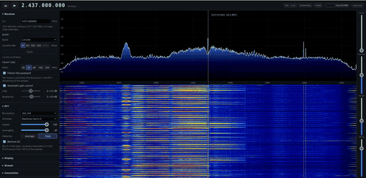

# openwrt-one-sdr

Turns an [OpenWrt One](https://openwrt.org/toh/openwrt/one) router into a
wideband, receive-only software-defined receiver. The board's MediaTek MT7981B
Wi-Fi SoC (with an MT7976 radio front end) captures raw 14-bit IQ from the
2.4 and 5 GHz bands at 40 Msps, the dual Cortex-A53 streams it over the 2.5 GbE
port as VITA 49, and a Linux host shows it as a live spectrum and waterfall in
the browser.

It runs on stock OpenWrt. The capture engine, the DMA producer and the network
export are driven from a kernel module built against OpenWrt's own mt76 driver
and a small patch injected into the MediaTek Wi-Fi firmware at build time; no
MediaTek firmware binary is redistributed here. MAC transmission is disabled
during armed capture; the stock Wi-Fi stack can transmit during boot, priming
and after capture stops.

The approach follows [W1700K-SDR](https://github.com/h0m3us3r/w1700k-sdr) on the
MT7996. The host spectrum viewer is a lightly modified MIT variant of that
project's viewer (vendored with full credit under
[host/spectrum/](host/spectrum/)), fed by a bridge that converts this project's
VITA 49 stream into the format it reads.

<p align="center">
  
</p>

<p align="center"><em>An earlier HE20 capture: the OpenWrt One receiving a live ~20 MHz slice of the 2.4 GHz band at 40 Msps.
The MT7981 radio streams 14-bit IQ as VITA 49 over the 2.5 GbE port to a Linux host, where the vendored
viewer renders the live spectrum (upper trace) and waterfall (lower panel) in the browser. The moving
energy is real Wi-Fi traffic in the local environment.</em></p>

## What it does

| | |
| --- | --- |
| Sample rate | 40 Msps complex, native 14-bit IQ; bounded runs pass, indefinite continuity remains unproven |
| Band | 2.4 GHz and 5 GHz U-NII-1, configured and read back at 40 MHz channel width, 40 Msps each. 2.4 GHz uses monitor mode to avoid AP coexistence fallback. Tuning uses HE40 block centres (see limitations) |
| Transport | kernel worker copies/converts capture data into UDP packets on the 2.5 GbE port; no userspace relay |
| Format | VITA 49 (VRT): Signal-Data packets carrying Ci8 or Ci16 (full 14-bit), a periodic IF-Context packet announcing centre frequency, sample rate and data format. A packed 14-bit profile is decoded by the bridge and SoapyVITA49; no device packer emits it yet. Also a legacy fixed-header mode |
| Control | the vendored viewer drives the board over its on-device C2 daemon (UDP, no SSH); an experimental VITA 49.2 command subset (tune/rate) serves SoapySDR/VITA 49.2 applications. Gain and bandwidth changes are unsupported; unchanged bandwidth/rate requests are acknowledged. Live Soapy frequency commands and resumed Ci16 reads passed with the timeout-fixed client and explicit C2 capture start/stop |
| Smoothness | the MAC is held receive-only (ARB_SCR TX-disable) during capture, as W1700K's firmware does, reducing contention; bounded clean runs do not establish indefinite operation |
| Host | a VITA 49 → shared-memory bridge feeds W1700K-SDR's `w1700k-spectrum` (262k-point FFT, browser UI); VITA receiver compatibility depends on the supported packet profile |

40 Msps is the validated operating rate. Ci16 preserves the captured 14-bit
components. At 80 Msps, Ci16 needs 2.56 Gb/s before packet overhead and cannot
fit 2.5 GbE. Ci8 fits; one bounded transport test delivered all 819.2 million
sample words in 10.24 seconds, but that HE20 test contained repeated samples
and does **not** prove 80 MHz RF bandwidth or 80 million independent samples/s.
Packed-14 device output remains unimplemented. 40 MHz channel width on both
bands at 40 Msps Ci16 was confirmed in bounded on-hardware tests; calibrated
passband flatness and indefinite gap-free operation remain unproven.

## Design approach and limitations

This project drives the **stock** MediaTek Wi-Fi firmware from Linux (plus a
small injected firmware producer), rather than replacing it with a full custom
WM as [W1700K-SDR](https://github.com/h0m3us3r/w1700k-sdr) does on the MT7996.
The stock stack handles radio bring-up, with the following implemented profiles
and verification limits:

- **Tuning uses HE40 block centres.** Supported centres are 2422–2462 MHz
  in 5 MHz steps on 2.4 GHz, and 5190/5230 MHz on 5 GHz. The controller snaps
  requests to this grid. These are the block centres reported by `iw center1`,
  rather than the primary Wi-Fi channel. Regulatory availability still applies.
- **40 MHz channel width on both bands.** The operating width is verified before
  capture; a fallback to 20 MHz is rejected. The 40 Msps complex stream spans
  40 MHz, but calibrated passband flatness, edge response and alias rejection
  have not been measured. Ambient Wi-Fi spectra cannot establish a flat ±20 MHz
  response; no such flatness claim is made.
- **40 Msps operating profile.** Both bands use their verified sample-lane layout.
  Higher transport throughput alone does not establish higher RF bandwidth or
  independent sample rate. Long-run continuity remains a separate validation.
- **~25 s per retune or band change.** A tune reloads the Wi-Fi radio and waits
  to settle; it is not an instant mid-stream hop.
- **5 GHz limited to U-NII-1 (5170–5260 MHz).** Higher 5 GHz channels are
  DFS/regulatory-gated through the Wi-Fi stack.

A full custom-WM port could provide more control over tuning and capture, at
the cost of a large reverse-engineering effort with uncertain gain on this SoC.
The resulting firmware is a patch on MediaTek's proprietary blob and is not redistributable as a built binary — see
[docs/reproduce.md](docs/reproduce.md).

## Repository

| Directory | Contents |
| --- | --- |
| [firmware/](firmware/README.md) | the nds32 DMA producer injected into the MediaTek Wi-Fi firmware, and the build/patch tooling |
| [kernel/](kernel/README.md) | the mt76 (mt7915) driver patches: the ICAP capture knobs and the kernel VITA 49 UDP sender |
| [host/](host/README.md) | host-side tools: the VITA 49 → shared-memory bridge, a VITA 49 emitter and receiver, receiver control (the VITA 49.2 responder and a network adapter for the vendored viewer, no SSH), and the viewer itself |
| [tools/](tools/README.md) | on-device control scripts and the C2 daemon |
| [docs/](docs/README.md) | architecture, the live-capture recipe, the control-plane map, the port plan |
| [include/](include/hw/README.md) | hardware register reference for the MT7981 capture path |
| [platform/](platform/README.md) | firmware-guard and boot-partition tooling for test images |


## Getting started

Hardware: an OpenWrt One, a Linux host with a 2.5 GbE interface cabled to the
board's 2.5 GbE (WAN) port, and SSH access to the board over its LAN port.

There are two ways in: start from the **release** (no firmware building), or
**build everything from source**. Both finish at the same place — an SDR
firmware that is patched locally on your own board and never redistributed (see
[Design approach](#design-approach-and-limitations) for why).

### A — From the release (no toolchains)

1. **Flash** the OpenWrt One with the release image
   `openwrt-one-sdr-*-squashfs-sysupgrade.itb` (a standard OpenWrt sysupgrade: it
   carries the stock MediaTek firmware and this project's driver). The board
   boots to its LAN at `192.168.1.1`.
2. **Set up** from your host — unpack the `sdr-tools` bundle from the same
   release and run the one command (needs only `ssh`/`scp` and Python 3):
   ```sh
   ./setup.sh <board-lan-ip>
   ```
   It copies the board's *own* stock firmware back to your host, patches it into
   the SDR firmware locally with `apply-producer.py` (no nds32 toolchain),
   installs the driver, tools, boot guards and services, and enables guarded
   boot. Then reboot the board.
3. **Build the host viewer and bridge** (light — only a host C/C++ compiler) and
   bring the link up:
   ```sh
   make -C host/spectrum                 # the vendored viewer (zlib + FFTW3f)
   cc -O2 -I host/stream/include -o vita49-shm host/stream/vita49-shm.c -lrt
   init/host-link.sh <your-2.5GbE-iface> # sets the host to 10.77.0.11/24
   ```
4. **Stream and view:**
   ```sh
   ./vita49-shm --port 4991 --stream /w1700k-stream &
   host/spectrum/build/w1700k-spectrum --center 2437 --rate 40 \
       --stream /w1700k-stream --listen 127.0.0.1:8073
   ```
   Open <http://127.0.0.1:8073> and tune from the viewer — it drives the board
   over its on-device C2 daemon, with no SSH in the loop.

See [release/README.md](release/README.md) for exactly what the release contains
and how it is built.

### B — From source

Pinned inputs (full, exact procedure in [docs/reproduce.md](docs/reproduce.md)):
OpenWrt at tag **v24.10.0-rc2** (commit `66e76aa9`), target `mediatek/filogic`;
an nds32 cross toolchain built from **GCC 10.5.0 + GNU Binutils 2.42**; the
MediaTek firmware the board already carries (never fetched or committed here).

```sh
# 1. OpenWrt base + the mt76 driver with this project's patches applied
#    (produces the firmware image and the mt7915e.ko build tree)
docs/reproduce.md  # step-by-step: clone, pin, patch, build

# 2. the nds32 toolchain, then the DMA-producer firmware patch
python3 firmware/streaming/build.py /tmp/fw --pool   # patches a local firmware copy

# 3. host tools
make -C host/spectrum
cc -O2 -I host/stream/include -o vita49-shm host/stream/vita49-shm.c -lrt

# 4. stage the driver, firmware, tools and services to a board with gold backups
init/deploy.sh <board-ip>   # then reboot to apply
```

`init/deploy.sh` stages the module, firmware and tools and enables boot
preparation and the responder service; a reboot applies the pair before module
loading, and no live driver reload is attempted. A failed or unclean SDR run
latches the next boot into stock recovery. This was confirmed on a real cold
boot: after an unclean power-off the board came up on stock firmware and required
an explicit `rearm` before it would re-enter SDR mode — the guarded recovery
behaving exactly as designed. See [init/README.md](init/README.md).

### Both paths

The 2.5 GbE port is the board's WAN port and carries the stream and control;
manage the board over its LAN port (`192.168.1.1`), since the WAN zone is locked
down by default. Setup, deploy and the boot service set the SDR link's fixed
address and open the control port automatically — see
[init/README.md](init/README.md) for the port/firewall topology.

A clean, flashable OpenWrt image may be built and distributed under its licences
together with the corresponding source; the MediaTek firmware blob it carries is
the one OpenWrt itself ships. The SDR firmware is produced locally from that
blob — on the board (source build) or on your host from the board's own copy
(release setup) — and is not redistributed by this project.

Build requirements (host): a C/C++17 compiler, make, git, Python 3.10+, zlib and
FFTW3 (single precision) for the viewer, and the OpenWrt build prerequisites if
building the base image.

## Read before use

- **Capture is receive-only.** The MAC is held receive-only during capture.
  Normal Wi-Fi boot/priming and post-capture operation can transmit. Do not cable an
  antenna port into a sensitive instrument without an attenuator.
- **The capture is finicky to establish.** It needs the radio up and settled
  (about 25 s after `wifi up`); starting a capture immediately after a radio
  reset overruns at once. See
  [docs/live-capture-recipe.md](docs/live-capture-recipe.md).
- **Recovery depends on boot configuration.** An enabled SDR service can select
  the patched pair on a clean reboot. Its persistent failure marker selects gold
  after an unclean run; see [init/README.md](init/README.md). This was verified on
  a real cold boot: an unclean power-off returned the board to stock and required
  an explicit `rearm` to re-enter SDR mode.
- **MediaTek firmware is proprietary.** This repository patches a copy already
  present on the board; it commits and redistributes none of it.

## Licence

Distributed under more than one licence, each file tagged with its own SPDX
line; full texts in [LICENSES/](LICENSES/). The host software, firmware tooling,
docs and scripts are MIT; the mt76 driver patches are ISC (keeping MediaTek's
copyright); the vendored spectrum viewer is MIT, © 2026 h0m3us3r. See
[LICENSE](LICENSE).
